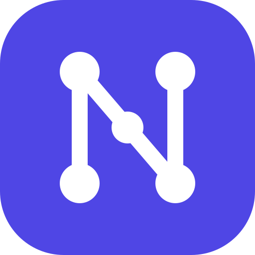

<p align="center"></p>

# Nemus agent kit

[Nemus](https://nemus.fyi) is a graph-based task manager: tasks are nodes, relationships are edges. This repo connects any MCP-capable agent to your Nemus workspace and adds a few skills for planning and tracking work as a graph.

- **MCP server:** `https://api.nemus.fyi/mcp` (Streamable HTTP, OAuth sign-in, no API key to paste)
- **Skills:** `plan-with-nemus`, `whats-blocking`, `project-catch-up`, `log-work-to-nemus`

A free Nemus account is enough to start: [app.nemus.fyi](https://app.nemus.fyi).

## Install

### Claude Code

```bash
claude plugin marketplace add nemus-fyi/nemus-agent-kit
claude plugin install nemus@nemus
```

Or just the server: `claude mcp add --transport http nemus https://api.nemus.fyi/mcp`

### Claude (web and desktop)

Settings → Connectors → search for **Nemus**.

### Skills only (Claude Code, Codex, Cursor and other agents)

```bash
npx skills add nemus-fyi/nemus-agent-kit
```

### Cursor

Add to `~/.cursor/mcp.json`:

```json
{ "mcpServers": { "nemus": { "url": "https://api.nemus.fyi/mcp" } } }
```

### Codex CLI

```bash
codex mcp add nemus --url https://api.nemus.fyi/mcp
```

### Gemini CLI

```bash
gemini extensions install https://github.com/nemus-fyi/nemus-agent-kit
```

### VS Code and other clients

Add a remote MCP server with URL `https://api.nemus.fyi/mcp`. Your client opens a browser window to sign in.

## What the agent can do

Projects, tasks (with status, priority, dates, owners), relationships (`BLOCKS`, `EXPANDS`, `RELATED_TO`, `CAUSES`), comments, references (PRs, docs, designs), assignments, notifications, Dynamic Views and Drawboard pins. Access follows your Nemus permissions.

## Skills

| Skill | Use it for |
|---|---|
| `plan-with-nemus` | Turn a brief or notes into a connected task graph |
| `whats-blocking` | Walk blocker chains and find the next unblocking move |
| `project-catch-up` | Short status update or "what's on my plate" |
| `log-work-to-nemus` | Update the matching task after a coding session, with PR links |

## Links

[Website](https://nemus.fyi) · [Privacy](https://app.nemus.fyi/privacy) · [Terms](https://app.nemus.fyi/terms) · Support: hi@nemus.fyi
